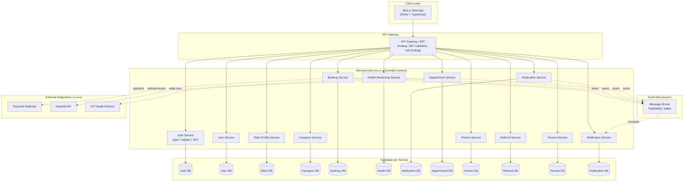

# Microservices Architecture — Eldercare Tech

อ้างอิงแนวคิดจากตัวอย่าง Netflix microservices
(<https://dev.to/somadevtoo/10-things-you-can-learn-from-netflixs-architecture-1bnn>)

## สถานะปัจจุบันของโปรเจค (ข้อเท็จจริง)

ระบบที่ implement จริงใน repo นี้ตอนนี้เป็น **monolith** ไม่ใช่ microservices:

- Frontend: Next.js app เดียว (`app/`)
- Backend: FastAPI app เดียว (`backend/app/main.py`) ที่รวม 12 routers
  (auth, users, elders, caregivers, bookings, health, medications,
  appointments, partners, referrals, reviews, notifications) ไว้ใน
  process เดียว, ต่อ database เดียว (SQLite ตอน dev / MySQL ตอน prod
  ผ่าน `docker-compose.yml`)

ไดอะแกรมด้านล่างคือ **แผนออกแบบ (proposed design)** ว่าถ้าจะแตกระบบนี้
เป็น microservices จริง ควรแบ่ง service ตามขอบเขตธุรกิจ (bounded
context) อย่างไร โดย map 1:1 กับ router ที่มีอยู่แล้ว เพื่อให้เห็น
เส้นทางการ migrate จาก monolith → microservices ในอนาคต

## Diagram

## Mapping service ↔ โค้ดปัจจุบัน

| Proposed Service | โค้ดปัจจุบัน (monolith) |
| --- | --- |
| Auth Service | `backend/app/routers/auth.py`, `core/security.py` |
| User Service | `backend/app/routers/users.py` |
| Elder Profile Service | `backend/app/routers/elders.py` |
| Caregiver Service | `backend/app/routers/caregivers.py` |
| Booking Service | `backend/app/routers/bookings.py` |
| Health Monitoring Service | `backend/app/routers/health.py` |
| Medication Service | `backend/app/routers/medications.py` |
| Appointment Service | `backend/app/routers/appointments.py` |
| Partner Service | `backend/app/routers/partners.py` |
| Referral Service | `backend/app/routers/referrals.py` |
| Review Service | `backend/app/routers/reviews.py` |
| Notification Service | `backend/app/routers/notifications.py` |

## เหตุผลที่ยังไม่แตกเป็น microservices จริงในเฟสนี้

- ขนาดทีม/ขอบเขตงานยังเล็ก (project การศึกษา) — monolith ดูแลง่ายกว่า
  และ deploy ง่ายกว่าในช่วง MVP
- ยังไม่มี load เพียงพอที่ทำให้ต้อง scale แต่ละ domain แยกกัน
- การแตก microservices เพิ่ม operational overhead (service discovery,
  distributed tracing, data consistency ข้าม service) ซึ่งเกินความ
  จำเป็นของ Phase ปัจจุบัน

แผนนี้จึงเป็น target architecture สำหรับ Phase ต่อไปถ้าระบบขยายใหญ่ขึ้น
