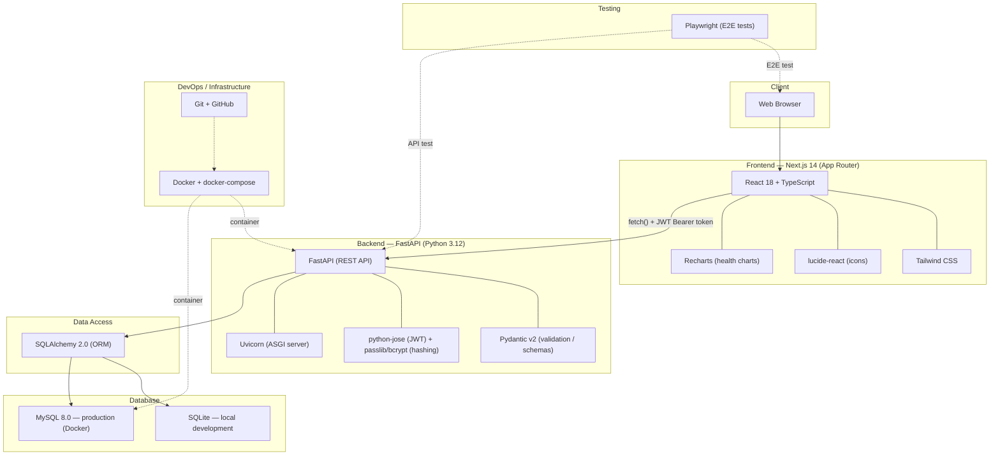

# Technology Stack Diagram — Eldercare Tech

อ้างอิงรูปแบบจากตัวอย่าง Technology stack diagram ของระบบ S2S School
Management System
(<https://www.researchgate.net/figure/Technology-stack-diagram-of-the-proposed-S2S-school-management-system_fig1_336641242>)

## Diagram

## รายละเอียดแต่ละ layer

| Layer | เทคโนโลยี | หน้าที่ |
| --- | --- | --- |
| Client | Web Browser | ผู้ใช้ (family / caregiver / admin) เข้าถึงระบบผ่านเว็บ |
| Frontend | Next.js 14, React 18, TypeScript | Routing, UI components, type safety |
| Frontend (styling) | Tailwind CSS | Utility-first styling, responsive design |
| Frontend (UI libs) | lucide-react, Recharts | Icon set, กราฟข้อมูลสุขภาพ |
| Backend (API) | FastAPI, Uvicorn | REST API, ASGI server |
| Backend (validation) | Pydantic v2 | Request/response schema validation |
| Backend (security) | python-jose, passlib + bcrypt | ออก/ตรวจสอบ JWT, hash รหัสผ่าน |
| Data access | SQLAlchemy 2.0 | ORM เชื่อม backend กับฐานข้อมูล |
| Database | SQLite (dev), MySQL 8.0 (prod) | เก็บข้อมูล user, elder, booking, health ฯลฯ |
| Infrastructure | Docker, docker-compose | containerize backend API + MySQL สำหรับ deploy |
| Version control | Git, GitHub | source control, collaboration |
| Testing | Playwright | end-to-end test ครอบคลุม login → dashboard CRUD |

## Data flow โดยสรุป

1. ผู้ใช้เปิดเว็บผ่าน browser → Next.js render หน้า UI
2. หน้าเว็บเรียก REST API ของ FastAPI backend ด้วย `fetch()` พร้อม JWT
   ที่ได้จาก `/api/auth/login`
3. FastAPI validate request ด้วย Pydantic → เรียก SQLAlchemy ORM
4. SQLAlchemy อ่าน/เขียนข้อมูลใน SQLite (dev) หรือ MySQL (prod ผ่าน
   Docker container)
5. Response กลับไปที่ Next.js แสดงผลเป็น UI (cards, charts, tables)
